  

  

  
  
  

  

## `> ls ~/arsenal`

  
  
  
  
  
  
  
  
  
  

## `> ./projects --featured`

<table>
  <tr>
    <td width="50%"></td>
    <td width="50%"></td>
  </tr>
  <tr>
    <td width="50%"></td>
    <td width="50%"></td>
  </tr>
</table>

  

## `> tail -f ~/activity.log`

  
  

  

  

## `> cat ~/mission.txt`

- [x] Build role-based access control into Flask apps
- [ ] Master the OWASP Top 10 and secure coding
- [ ] Solve CTF challenges (HackTheBox, TryHackMe, picoCTF)
- [ ] Learn network and web penetration testing, ethically
- [ ] Apply machine learning to security problems

## `> ./connect.sh`

  
  
  
  

  

